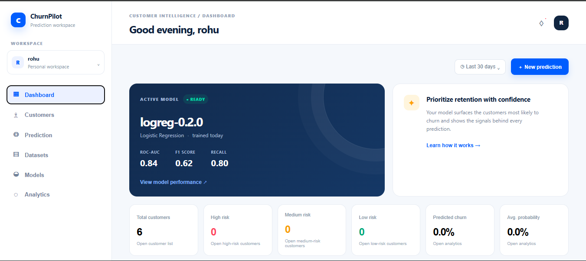
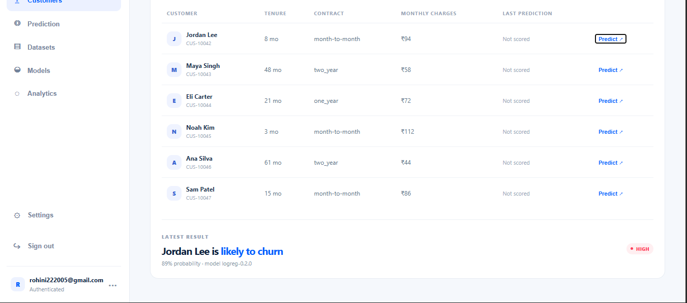
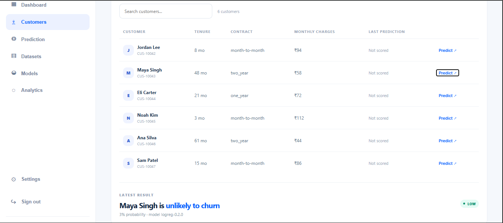

# Customer Churn Prediction System

A solo-developer production-style churn prediction web application.

## Current implementation slice

This first implementation slice is runnable locally and includes:

- FastAPI API with a demo in-memory store
- Logistic Regression model trained at startup on the public Telco Customer Churn dataset (7,043 customers)
- CSV upload and validation
- Customer list/detail endpoints
- Single-customer prediction with probability, risk level, and model-based feature factors
- Basic dashboard analytics endpoints
- React + Vite + TypeScript dashboard shell
- Responsive customer table and prediction workspace
- Local signup/login authentication gate
- Persistent local development accounts with logout/session validation

The current slice intentionally uses an in-memory demo store so the full workflow can be exercised before wiring Supabase PostgreSQL/Auth/Storage. The database/backend/ML specifications remain the source of truth for the next implementation slice.

## Dataset and model

## Results

Trained on the Telco Customer Churn dataset (7,043 customers, ~26.5% churn) with an
80/20 stratified train/test split and balanced class weights.

| Metric    | Test set |
|-----------|----------|
| ROC-AUC   | 0.84     |
| Recall    | 0.80     |
| Precision | 0.51     |
| F1        | 0.62     |
| Accuracy  | 0.74     |
| PR-AUC    | 0.64     |

Because only ~27% of customers churn, accuracy alone is misleading (always predicting
"no churn" scores ~73%). ROC-AUC and recall are the main measures: the model finds about
80% of churners, at the cost of some false alarms (precision 0.51).

Metrics come from a single train/test split with a fixed random seed.

## Screenshots





**Why a prediction is high or low.** For each customer the API returns the five features that move the prediction most. For a logistic regression this is computed exactly: contribution = model weight x (the customer's value - the average training value). Contributions from one-hot columns are summed per original column, so "Contract type" is one number. Positive values push towards churn, negative values away from it; the `impact` is in log-odds units.

## Run the backend

```bash
cd backend
../.venv/bin/uvicorn app.main:app --reload --port 8000
```

Open API docs at `http://localhost:8000/docs`.

## Run the frontend

```bash
cd frontend
npm install
npm run dev
```

The frontend expects `VITE_API_BASE_URL=http://localhost:8000`.

## Repository layout

- `frontend/` React/Vite client
- `backend/` FastAPI API and ML integration
- `ml/` reserved for the extracted reusable ML package in the next slice
- `data/sample/` small CSV fixtures for trying the upload flow
- `prepare_telco.py` cleans the raw Telco CSV into `data/telco_clean.csv`
- `docs/` implementation notes

## Next implementation slice

1. Replace the in-memory store with SQLAlchemy repositories and Supabase PostgreSQL.
2. Add Supabase Auth JWT verification and owner-scoped access.
3. Move model artifacts to private Supabase Storage.
4. Add the full dataset/training/prediction persistence schema.
5. Add SHAP explanations and the complete model-comparison workflow.
